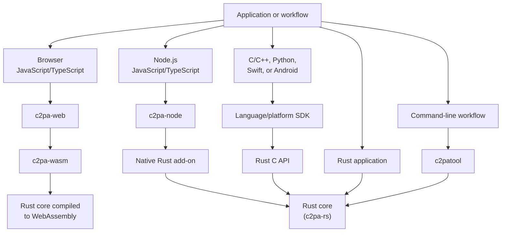

import cr_pin from '@site/static/img/cr-pin.png';

The Content Authenticity Initiative (CAI) open-source SDK is a family of libraries and tools for working with **Content Credentials**, cryptographically signed provenance information based on standards developed by the [Coalition for Content Provenance and Authenticity (C2PA)](https://c2pa.org/). Use the SDK to read and validate existing credentials, create manifests describing an asset's provenance, and sign and attach manifests to supported media files.

Choose a library based on **where your code runs**. The libraries share a Rust core, but their APIs, deployment requirements, and platform integrations differ.

For background on Content Credentials, read [Getting started](getting-started/index.mdx). For technical concepts and common tasks, see [Understanding manifests](manifest/understanding.md) and [Working with the SDK](tasks/index.md).

:::tip See also
For educational videos on using the CAI open-source SDK, see [**Content Credentials Foundations**](http://learn.contentauthenticity.org/).
:::

## Which library should I use?

| What are you building? | Recommended SDK or tool | Why choose it? |
| --- | --- | --- |
| Browser application | [**c2pa-web**](sdk-repos/c2pa-js/packages/c2pa-web/README.md) | JavaScript and TypeScript APIs backed by WebAssembly for working with media in the browser. |
| Node.js application, API, or processing service | [**c2pa-node**](sdk-repos/c2pa-js/packages/c2pa-node/README.md) | JavaScript and TypeScript APIs backed by a native Rust add-on, suited to server-side media processing. |
| Python application or processing pipeline | [**Python library**](sdk-repos/c2pa-python/readme.md) | Integrate C2PA operations into Python applications, scripts, and services. |
| Native C or C++ application | [**C/C++ library**](sdk-repos/c2pa-cpp/readme.md) | Use native APIs backed by the Rust SDK's C interface. |
| iOS or macOS application | [**Swift library**](sdk-repos/c2pa-swift/README.md) | Native Swift APIs and integrations with Apple platforms, including supported hardware-backed signing. |
| Android application | [**Android library**](sdk-repos/c2pa-android/README.md) | Kotlin APIs and Android integrations, including supported hardware-backed signing. |
| Rust application | [**Rust library**](sdk-repos/c2pa-rs/readme.md) | Integrate directly with the core implementation. |
| Command-line workflow, prototype, or inspection task | [**C2PA Tool**](sdk-repos/c2patool/readme.md) | Inspect and validate manifests or create and attach signed manifests without writing an application. |

For an overview of platform-specific mobile options, see [Mobile libraries](mobile.md).

The [JavaScript SDK repository](sdk-repos/c2pa-js/README.md) contains both browser and Node.js packages. For application development, choose **`@contentauth/c2pa-web`** or **`@contentauth/c2pa-node`** rather than treating `c2pa-js` as a single interchangeable library.

:::note Library capabilities
Supported asset formats, signing algorithms, platform integrations, and individual APIs depend on the library and release. Signing also requires an appropriate signer and certificate; installing an SDK library does not supply a production signing identity.
:::

Creating or updating provenance normally means creating a new signed manifest that records the operation and relevant source assets, rather than editing an existing signed manifest in place.

C2PA Tool is useful for inspection, scripts, and prototypes. For applications that repeatedly process assets, a language library generally provides more direct integration than launching a separate command-line process for every operation.

## SDK architecture overview

The [Rust library](sdk-repos/c2pa-rs/readme.md), `c2pa-rs`, provides the shared implementation for manifest processing, validation, signing, and media format support. Applications can use it directly or through a language-specific SDK.

The wrappers adapt the shared functionality to their environments. For example, browser applications work with browser media objects and WebAssembly, Node.js applications use a native add-on, and mobile SDKs integrate with platform-specific APIs.

A shared core does **not** mean every SDK release exposes every feature or supports every platform and media format. Use the documentation for the SDK and version you install.

### Native and embedded integrations

For most integrations, use an existing language library. For integrations not covered by those libraries, Rust's _foreign function interface_ (FFI) enables interoperability with other languages.

Embedded environments can have additional constraints, including limited memory, low-powered hardware, intermittent connectivity, unusual operating systems, or bare-metal execution. Contact the CAI team before planning an embedded integration. Don't assume that a desktop library or prebuilt binary will work unchanged.

## JavaScript applications

### Browser applications

Use [`@contentauth/c2pa-web`](sdk-repos/c2pa-js/packages/c2pa-web/README.md) for JavaScript or TypeScript that runs in a browser.

The current browser SDK is **not limited to viewing credentials**. It provides APIs for reading and validating manifests, building manifests and adding ingredients, and producing signed output assets with a supplied signer.

When developing an application for the browser environment:

- Configure loading of the WebAssembly binary and worker for your bundler and deployment environment.
- Prefer a separately loaded WebAssembly resource for most deployments. The `/inline` entry point is an alternative when a separate resource is impractical, but it increases the JavaScript bundle size.
- Follow the SDK's guidance on releasing readers and builders when they are no longer needed.
- Build your own presentation layer for provenance information, following the [C2PA user experience recommendations](https://spec.c2pa.org/specifications/specifications/2.2/ux/UX_Recommendations.html).

### Node.js applications

Use [`@contentauth/c2pa-node`](sdk-repos/c2pa-js/packages/c2pa-node/README.md) for server-side applications, media-processing services, and other supported Node.js environments.

This package uses a native add-on rather than the browser WebAssembly runtime. Check the package's supported Node.js versions, operating systems, and architectures when choosing a deployment target. It is not a browser dependency.

### Full-stack applications

A full-stack application can use `c2pa-web` for browser-side inspection or manifest preparation and `c2pa-node` for back-end validation, processing, and signing. Both packages are in the [c2pa-js monorepo](sdk-repos/c2pa-js/README.md).

:::warning Protect signing keys and back-end decisions
Never bundle production private keys or signing-service credentials into browser JavaScript. Use an appropriately protected signing implementation, such as an authenticated back end or supported key provider.

If back-end decisions depend on an uploaded asset's credentials, validate the asset on the back end rather than trusting validation results supplied by the browser.
:::

Most applications should use the public `c2pa-web` or `c2pa-node` package rather than integrating directly with supporting packages such as `c2pa-wasm`.

## More information

C2PA and CAI work together to develop and promote adoption of an open industry standard for content authenticity and provenance.

| Website | Organization | Purpose / description |
| --- | --- | --- |
| [c2pa.org](https://c2pa.org/) | C2PA / Linux Foundation | Standards body Technical specifications and guidance documents |
| [contentcredentials.org](https://contentcredentials.org/) | C2PA | Consumer-friendly site |
| [contentauthenticity.org](https://contentauthenticity.org/) | CAI | Industry consortium Open-source software and community resources |

### C2PA

The Coalition for Content Provenance and Authenticity (C2PA) provides technical specifications and open standards for content provenance. These support creators, editors, publishers, media platforms, and consumers. C2PA is a mutually governed standards development organization (SDO) under the structure of the [Linux Foundation's Joint Development Foundation](https://jointdevelopment.org/).

#### The "cr" icon

The "cr" icon (or "cr" pin) is trademarked by C2PA and is the _de facto_ mark for C2PA user experiences. [Conforming products](conformance/index.mdx) can use the "Content Credentials" branding and the "Cr" pin to provide a consistent user experience and set expectations that an application, tool, or website implements C2PA standards.

:::info
For detailed guidance on using the "cr" icon, see [C2PA User Experience Guidance for Implementers](https://c2pa.org/specifications/specifications/2.0/ux/UX_Recommendations.html#_l1_indicator_of_c2pa_data).
:::

### CAI

**CAI** is an Adobe-led cross-industry consortium that advocates for the adoption of Content Credentials based on C2PA standards. CAI develops and maintains open-source software based on C2PA technical specifications.

CAI members include Adobe, Microsoft, The New York Times Co., The Associated Press, Intel, Qualcomm, and many more.
